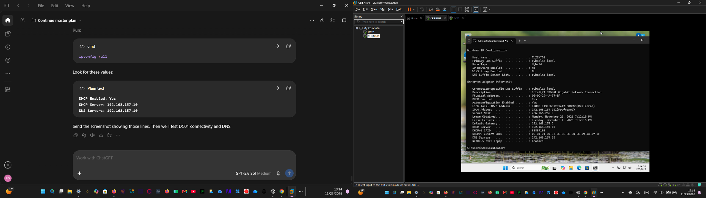
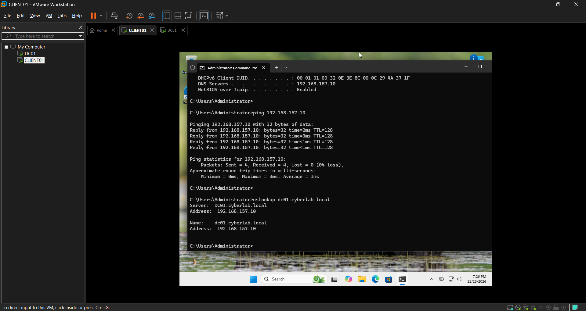
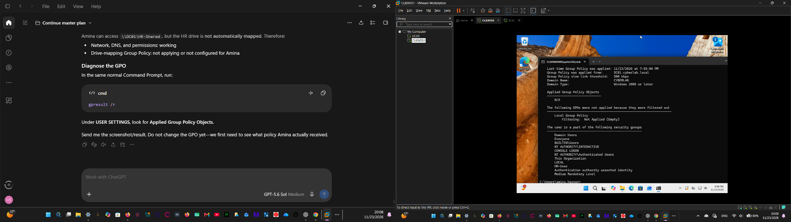
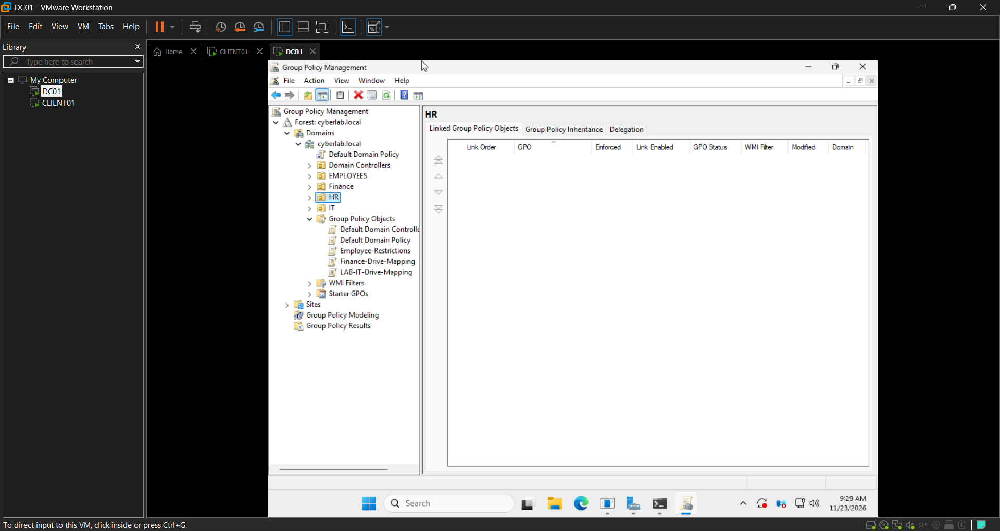
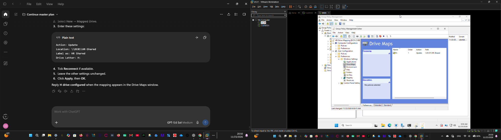
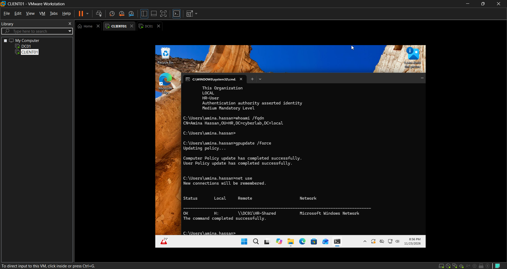
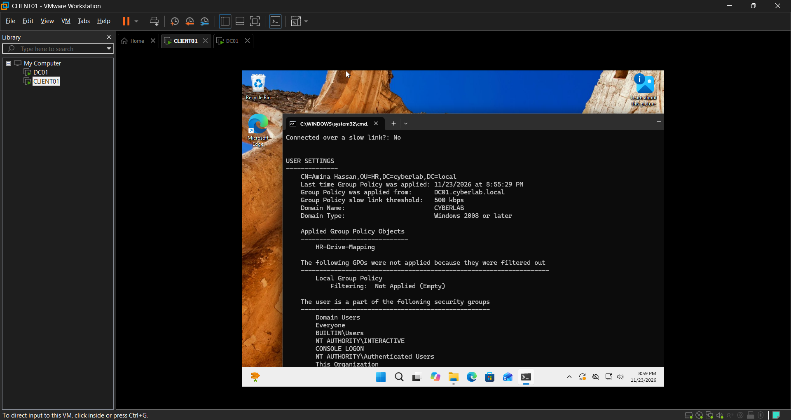
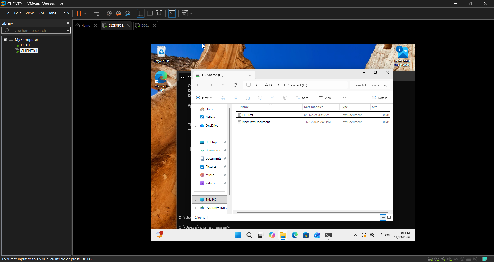

# Ticket 019 — CLIENT01 DHCP Recovery and HR Drive Mapping

## Incident summary

An HR user, **Amina Hassan**, could not reliably access the expected HR mapped drive on `CLIENT01`. During the investigation, the workstation was first found with an APIPA address (`169.254.x.x`), showing that it had not received a valid DHCP lease. After DHCP service and scope checks, the client obtained a valid address. The HR share was then reachable by UNC path, but the `H:` drive was still not mapped automatically.

The investigation established that network connectivity, DNS, authentication, and share permissions were working. The remaining fault was Group Policy: the HR organizational unit had no linked drive-mapping GPO. A new `HR-Drive-Mapping` GPO was configured and linked, after which the drive mapped successfully.

## Environment

| Component | Configuration |
| --- | --- |
| Domain | `cyberlab.local` |
| Domain controller | `DC01` — `192.168.157.10` |
| Client | `CLIENT01` |
| User | `cyberlab\amina.hassan` |
| User OU | `OU=HR,DC=cyberlab,DC=local` |
| DHCP scope | `192.168.157.100`–`192.168.157.200` |
| Default gateway | `192.168.157.2` |
| DNS server | `192.168.157.10` |
| Shared folder | `\\DC01\HR-Shared` |
| Required mapping | `H:` — **HR Shared** |

## Reported symptoms

- `CLIENT01` initially had an APIPA address in the `169.254.x.x` range.
- The HR share was not automatically available as drive `H:`.
- The user could open `\\DC01\HR-Shared` directly after network recovery.
- The user could create, read, and delete a test file in the share.
- `gpresult /r` initially showed no HR drive-mapping GPO under the applied user policies.

## Investigation and resolution

### 1. Verify DHCP on DC01

The DHCP Server service was confirmed as running. The DHCP PowerShell module was imported, then the IPv4 scope, authorization, and scope options were checked.

```powershell
sc query dhcpserver
Import-Module DhcpServer
Get-DhcpServerv4Scope
Get-DhcpServerInDC
Get-DhcpServerv4OptionValue -ScopeId 192.168.157.0
```

The checks confirmed:

- Active scope: `192.168.157.100`–`192.168.157.200`
- Authorized DHCP server: `dc01.cyberlab.local` / `192.168.157.10`
- Router option: `192.168.157.2`
- DNS server option: `192.168.157.10`
- DNS domain option: `cyberlab.local`

### 2. Renew the client lease

On `CLIENT01`, the existing address was released and a new DHCP lease requested.

```cmd
ipconfig /release
ipconfig /renew
ipconfig /all
```

The client received `192.168.157.101/24` with the correct gateway, DHCP server, and DNS server.



### 3. Validate network and DNS

```cmd
ping 192.168.157.10
nslookup dc01.cyberlab.local
```

The ping returned four replies with `0%` packet loss, and DNS resolved `dc01.cyberlab.local` to `192.168.157.10`.



### 4. Verify identity, OU placement, and share access

```cmd
whoami
whoami /fqdn
```

The user was authenticated as `cyberlab\amina.hassan` and located in the HR OU:

```text
CN=Amina Hassan,OU=HR,DC=cyberlab,DC=local
```

Opening `\\DC01\HR-Shared` succeeded. Creating, reading, and deleting a test file also succeeded, proving that SMB connectivity and the user's share/NTFS permissions were functional.

### 5. Diagnose Group Policy

```cmd
gpupdate /force
gpresult /r
net use
```

The first `gpresult /r` report did not show a drive-mapping GPO under **Applied Group Policy Objects**.



Group Policy Management on `DC01` also showed an empty **Linked Group Policy Objects** list for the HR OU.



### 6. Create and configure the drive-mapping GPO

A GPO named `HR-Drive-Mapping` was created and linked to the HR OU. The following user preference was configured:

```text
User Configuration
└── Preferences
    └── Windows Settings
        └── Drive Maps
```

| Setting | Value |
| --- | --- |
| Action | Update |
| Location | `\\DC01\HR-Shared` |
| Label | `HR Shared` |
| Drive letter | `H:` |
| Reconnect | Enabled |



### 7. Apply and validate the policy

On `CLIENT01`:

```cmd
gpupdate /force
net use
gpresult /r
```

`net use` showed the new mapping:

```text
OK    H:    \\DC01\HR-Shared    Microsoft Windows Network
```



`gpresult /r` now listed `HR-Drive-Mapping` under **Applied Group Policy Objects**.



File Explorer displayed **HR Shared (H:)**, and the share contents were accessible.



## Root cause

Two separate issues were identified:

1. `CLIENT01` had not obtained a valid DHCP lease and had assigned itself an APIPA address. The DHCP server configuration was healthy, and releasing and renewing the client lease restored a valid network configuration.
2. The HR mapped drive was absent because no drive-mapping GPO was linked to the HR OU. Direct UNC access worked, confirming that the problem was policy delivery rather than DNS, network connectivity, or permissions.

## Final validation

| Test | Result |
| --- | --- |
| Valid DHCP address | Pass — `192.168.157.101` |
| Default gateway | Pass — `192.168.157.2` |
| DNS server | Pass — `192.168.157.10` |
| Ping DC01 | Pass — 4 replies, 0% loss |
| Resolve `dc01.cyberlab.local` | Pass — `192.168.157.10` |
| Authenticate as Amina | Pass — `cyberlab\amina.hassan` |
| Access `\\DC01\HR-Shared` | Pass |
| Create/read/delete share file | Pass |
| `HR-Drive-Mapping` applied | Pass |
| `H:` mapped to HR share | Pass |

## Lessons learned

- An APIPA address is evidence that the client did not obtain a DHCP lease; it does not by itself prove that the DHCP service is stopped.
- Troubleshooting should move through the layers: IP configuration, connectivity, DNS, authentication, permissions, and then policy.
- Successful direct UNC access helps separate a permissions or connectivity problem from a drive-mapping policy problem.
- `gpresult /r` provides client-side proof of which policies were actually applied.
- A configured GPO has no effect on a user until it is correctly linked and within the user's scope.

## Security note

This case study uses an isolated training lab. No passwords or production credentials are included.

---

**Author:** Joel Njuguna Kangau  
**Portfolio:** [JOELNJUGUNA-IT/averine-active-directory-lab](https://github.com/JOELNJUGUNA-IT/averine-active-directory-lab)
