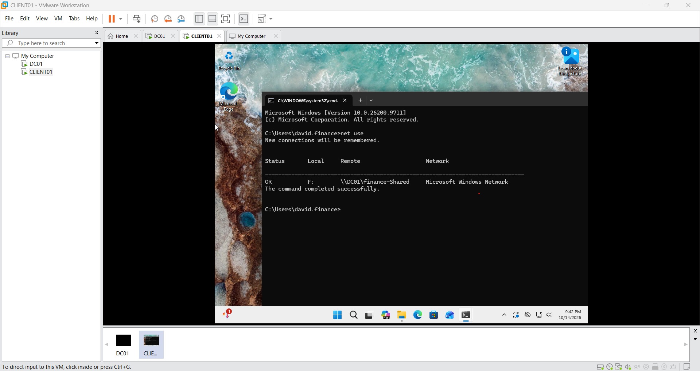

# Ticket #016 — Finance Network Drive Missing

## Environment
- Domain: cyberlab.local
- Domain Controller: DC01 — Windows Server 2025
- Client: CLIENT01 — Windows 11
- User: CYBERLAB\david.finance
- Department: Finance

## Problem
David reported that his Finance F: network drive was missing after signing in to CLIENT01.

## Troubleshooting
1. Ran `whoami` to confirm David was logged into the correct domain account.
2. Ran `ipconfig /all` to verify IP, DHCP, and DNS configuration.
3. Pinged `192.168.157.10` and received all four replies.
4. Used `nslookup dc01.cyberlab.local` to check DNS resolution.
5. Opened `\\DC01\Finance-Shared` successfully, confirming direct access to the shared folder.
6. Ran `net use`; no mapped drives were listed.
7. Ran `gpresult /r`; no applied user GPOs were listed.
8. Inspected the Finance OU in Group Policy Management and found no directly linked GPO.
9. Checked Group Policy Objects and found no `Finance-Drive-Mapping` GPO.

## Root Cause
The expected Finance drive-mapping Group Policy Object was missing, so the F: drive was not being mapped automatically.

## Resolution
1. Created a GPO named `Finance-Drive-Mapping`.
2. Configured User Configuration > Preferences > Windows Settings > Drive Maps.
3. Set Action to Update, Location to `\\DC01\Finance-Shared`, Reconnect enabled, Label to Finance Shared, and drive letter to F:.
4. Linked the GPO to the Finance OU.
5. On CLIENT01, ran `gpupdate /force` while logged in as David.

## Verification
- Computer and User Group Policy updates completed successfully.
- `net use` showed F: connected to `\\DC01\Finance-Shared`.
- Opened Finance Shared (F:) successfully in File Explorer.

## Evidence

## Lesson Learned
If a user can open a UNC share directly but the mapped drive is missing, investigate drive-mapping configuration and GPO application before changing network permissions.