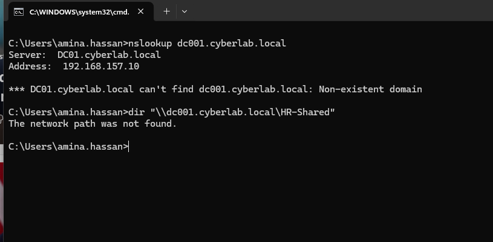
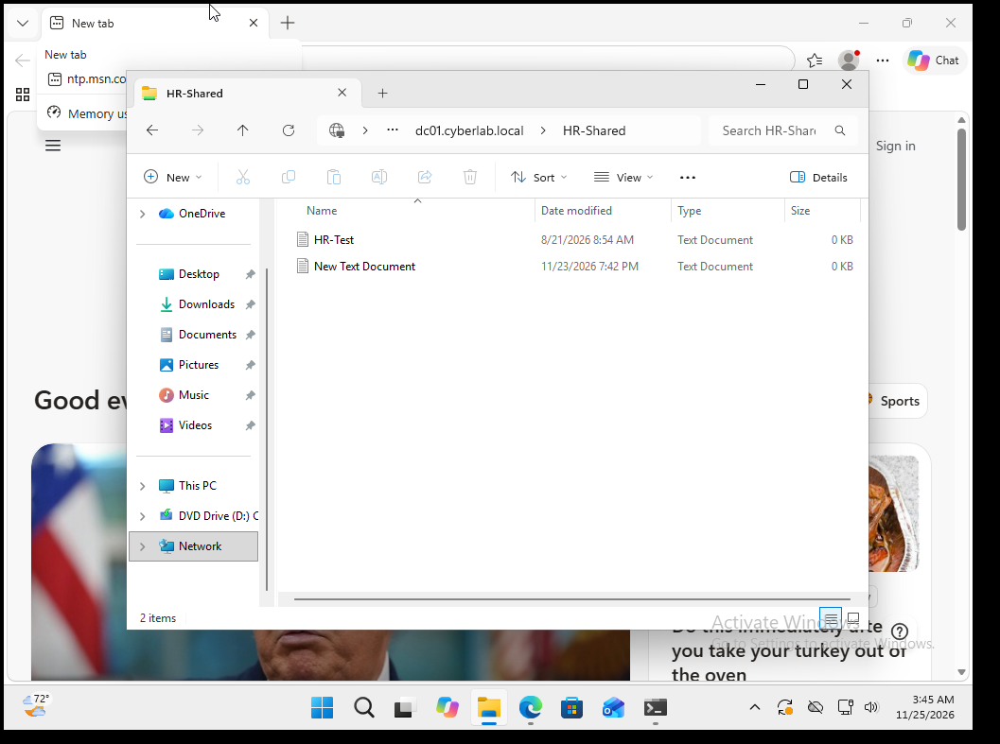

# Internet Works, but the HR Share Won’t Open

## Scenario

In this simulated help-desk ticket, an HR user on `CLIENT01` could browse the web but couldn’t open the HR network share using the supplied path.

## Investigation

1. Confirmed that a public website loaded from inside `CLIENT01`.
2. Ran `ping 192.168.157.10`. DC01 replied to all four requests with 0% packet loss.
3. Ran `nslookup dc01.cyberlab.local`. DNS returned the expected address: `192.168.157.10`.
4. Looked up the server name from the failing path: `dc001.cyberlab.local`. The DNS server replied “Non-existent domain.” Trying to list the share at that path returned “The network path was not found.”

## Cause and resolution

The supplied path had an extra zero in the server name: `dc001` instead of `dc01`. I opened `\\dc01.cyberlab.local\HR-Shared` in File Explorer and verified that the folder contents appeared. No DNS, permissions, or Group Policy settings were changed.

## Evidence

## Takeaway

Ask for the exact path the user tried. Internet access, server reachability, name resolution, and share access are separate checks.